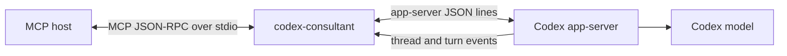

# codex-consultant

[](https://github.com/amu3dev/codex-consultant/actions/workflows/ci.yml)
[](LICENSE)
[](https://nodejs.org/)

Thin local MCP bridge for Codex app-server. Ask Codex for a focused second
opinion, continue a thread, or review a project through standard MCP tools—while
keeping the consultation read-only by default.

> This is an independent community project. It is not affiliated with or
> endorsed by OpenAI.

## Why this exists

Recent Codex CLI versions removed the deprecated `codex mcp-server` entry point.
This adapter uses the supported app-server interface instead:

```text
codex app-server --stdio
```

The adapter owns the protocol lifecycle, request correlation, event collection,
timeouts, diagnostics, and child-process cleanup so an MCP host only sees the
consultant tools and the final answer.

## Features

- `codex_consult` for a fresh read-only Codex thread;
- `codex_continue` using `thread/resume`;
- `codex_review` for a focused project review;
- optional working-directory and model overrides;
- `approvalPolicy: "never"` and read-only sandbox defaults;
- assistant streaming and terminal-turn tracking;
- JSON-RPC request correlation and newline-delimited framing;
- stderr-only diagnostics and protocol-only MCP stdout;
- bounded timeouts, malformed-frame handling, and graceful cleanup;
- deterministic offline checks plus live protocol and end-to-end smoke tests.

## Architecture



The app-server process starts lazily on the first Codex tool call and remains
alive for the MCP server lifetime. Each `codex_consult` call creates a fresh
thread. The adapter exposes no arbitrary shell-execution tool.

## Tools

| Tool | Input | Purpose |
|---|---|---|
| `codex_consult` | `{ prompt, cwd?, model? }` | Fresh read-only consultation |
| `codex_continue` | `{ threadId, prompt }` | Continue an existing thread |
| `codex_review` | `{ prompt, cwd }` | Read-only code or project review |

The final assistant answer is returned as the primary MCP text content. Minimal
metadata—thread ID, turn ID, model, status, duration, and assistant message ID—
is returned as structured content.

## Requirements

- macOS with the Codex CLI installed;
- Codex CLI 0.154.0 or a compatible app-server protocol;
- Node.js 22 or newer;
- an authenticated Codex session for live calls;
- an MCP host that supports local stdio servers.

The default binary path is `/opt/homebrew/bin/codex`. Change the source constant
if your installation uses another path.

## Install and verify

```bash
git clone https://github.com/amu3dev/codex-consultant.git
cd codex-consultant
npm ci
npm run check
```

`npm run check` runs typechecking, deterministic tests, the TypeScript build, and
an MCP initialize/tools-list smoke check. It does not require a live model call.

For a locally authenticated Codex installation, run the layered live checks:

```bash
npm run smoke:app-server  # raw app-server lifecycle
npm run smoke:wrapper     # TypeScript wrapper
npm run smoke:continue    # thread/resume lifecycle
npm run smoke:mcp         # complete MCP -> app-server -> model path
```

## MCP configuration

Build the server first and find the Node executable with `command -v node`.
Copy [`examples/mcp-config.json`](examples/mcp-config.json), replacing its three
`/absolute/path/to/...` placeholders:

```json
{
  "mcpServers": {
    "codex": {
      "command": "/absolute/path/to/node",
      "args": [
        "/absolute/path/to/codex-consultant/dist/index.js"
      ],
      "cwd": "/absolute/path/to/codex-consultant",
      "env": {
        "NODE_ENV": "production"
      }
    }
  }
}
```

No Codex API key belongs in this configuration. The adapter uses the local
Codex authentication and configuration already available to the app-server.

## Protocol and safety

The verified lifecycle is:

1. `initialize`;
2. `initialized`;
3. `thread/start`;
4. `turn/start`;
5. matching `item/agentMessage/delta`, `item/completed`, and `turn/completed`
   notifications.

Codex 0.154.0 accepts standard JSON-RPC requests with `"jsonrpc": "2.0"`, but
its server-emitted responses and notifications omit that member. The adapter
handles this current wire-format detail while rejecting malformed frames. See
[`docs/protocol.md`](docs/protocol.md) for the exact payloads and event contract.

The read-only policy is a least-authority default, not a guarantee that supplied
prompts or repository contents are non-sensitive. Choose `cwd` carefully and
minimize confidential context before invoking the tools.

## Development

Useful commands:

```bash
npm run typecheck
npm test
npm run build
npm run verify:mcp
npm run dev
```

See [`CONTRIBUTING.md`](CONTRIBUTING.md), [`SECURITY.md`](SECURITY.md), and
[`CHANGELOG.md`](CHANGELOG.md) before opening a pull request.

## License

MIT. See [`LICENSE`](LICENSE).
